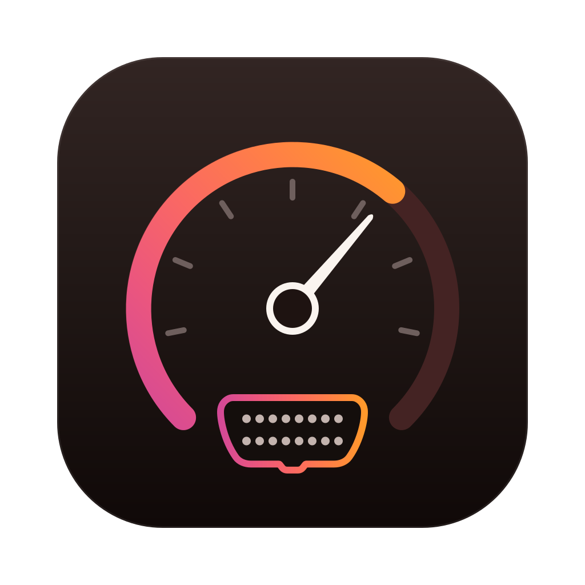

# freematics-emulator

A modern control app for the [Freematics OBD-II Emulator MK2](https://freematics.com/products/freematics-obd-emulator-mk2/).
It replaces the Windows-only GUI with a local server that owns the USB serial link and a web UI
that drives it, on macOS, Linux and Windows.

Under the hood: a Node WebSocket server built from Effect services, and typed RPC contracts
shared with a React client.

## Quick start

```sh
pnpm install
pnpm dev            # server on :3738 + web on :5738, open http://localhost:5738
```

To run it without the dev tooling, build the UI once and let the server serve it:

```sh
pnpm build
pnpm start          # open http://localhost:3738
```

## Desktop app

The desktop app (Electron) runs on macOS, Windows and Linux, x64 and arm64. It bundles the server
and the UI; nothing else needs to be installed.

```sh
pnpm desktop                  # build and open the app
pnpm desktop:dist             # installers for this OS into apps/desktop/release
pnpm desktop:dist --win       # or --mac, --linux; --dir for unpacked apps only
pnpm --filter @fme/desktop smoke   # check the packaged app for this OS
```

| OS      | Output                                                          |
| ------- | --------------------------------------------------------------- |
| macOS   | `.dmg` and `.zip` (unsigned: right-click → Open the first time) |
| Windows | NSIS installer `.exe` and a portable `.zip`                     |
| Linux   | `.AppImage` and `.deb`                                          |

Each OS builds its own installers best; the `Desktop` GitHub workflow does that on macOS, Windows
and Linux runners, smoke-tests each package and uploads them. From an Apple Silicon Mac, Linux
packages also build in Docker with `electronuserland/builder:wine`. The Windows installer step
needs Wine and fails there without Rosetta; `--win` still produces the zip.

On Linux, add yourself to the `dialout` group (`sudo usermod -aG dialout $USER`, then log in
again) to open serial ports; port discovery uses `udevadm`, which desktop distros ship.

Verify a connected MK2 end to end (every control set over RPC and read back from the device):

```sh
pnpm hardware:check   # with pnpm dev running
```

No hardware? Pick **Simulated device** in the connection bar. It speaks the same AT command set as
the MK2 firmware, so everything in the UI works end to end.

With hardware: power the emulator from its 12 V adapter, plug in USB with a data cable, and pick
its port. Current units use a CP2102 bridge (`/dev/cu.usbserial-*` on macOS), older ones a CH340
(`/dev/cu.wchusbserial*`); macOS ships drivers for both.

## Goals

**Primary: full control of the MK2 over USB**, verified against real hardware.

1. **Typed contracts** – `packages/contracts`: emulator state, inputs, errors and the WebSocket RPC
   group as Effect Schemas. ✅
2. **Protocol core** – `packages/shared`: AT command builders, line framing, the PID catalog with
   SAE J1979 encoders, PID 0101 readiness encoding. ✅
3. **Server** – `apps/server`: a USB serial device link, a simulated MK2 that matches the measured
   firmware behavior, a serialized AT client with timeouts and a traffic log, and an
   `EmulatorSession` service that owns device state. Thin WebSocket RPC on top. ✅
4. **Web UI** – `apps/web`: connection bar, ignition and protocol, PID controls, DTCs, VIN,
   readiness monitors, raw AT console with traffic log. ✅
5. **Verified end to end** – the app running against the real emulator over USB, every control
   checked by reading the value back from the device. ✅ (`pnpm hardware:check`: 20/20 on a V1.2
   unit; UI driven in the browser against the same unit.)

**Additional: wireless.**

6. **Scan tool read-back** – connect an ELM327-compatible OBD-II adapter plugged into the
   emulator (Bluetooth SPP, Wi-Fi or USB) and see what a vehicle reader gets: live PID values next
   to each control, stored codes, VIN, detected protocol. ✅ with the simulated adapter and a
   real Bluetooth ELM327 (`pnpm hardware:check --reader /dev/cu.OBDII`, 24/24). On macOS the
   adapter's port only answers once the Bluetooth link is connected.
7. **Emulator over BLE** – manage the MK2 through its built-in BLE serial link instead of USB.

**Later:** drive-cycle scenarios (scripted PID streams).

## Firmware notes (measured on a V1.2 unit)

- 38400 8N1 over a CP2102 (newer units) or CH340 bridge. Lines end in `\r`; `ATGET VIN` ends in
  `\r\n`. `ATGET <pid>` answers `010C=1F 40 `.
- Decimal `ATSET` truncates instead of rounding, rejects negatives, and mis-converts 015E, so the
  app always sends raw bytes from its own SAE encoders.
- `ATZ`/`ATR` reset every PID to zero and print `OBD-II EMULATOR V1.2` plus a hardware info line.
- `ATGET BUS`, CALID and Mode 07/0A DTCs answer `ERROR` on this firmware.
- On macOS, `serialport`'s kqueue poller never fires for the CP210x driver; the server reads the
  port through Node's TTY stream instead.

## Layout

```
apps/server         Node server: serial link, AT client, emulator session, WebSocket RPC, static web
apps/web            React + Vite client
packages/contracts  Effect Schema contracts shared by server and web
packages/shared     Pure protocol helpers (subpath exports, no barrel)
oxlint-plugin-fme   Lint rules that enforce the Effect and testing conventions
docs/internals      Conventions for contributors and agents (start from AGENTS.md)
```

## Scripts

| Command          | What it does                                        |
| ---------------- | --------------------------------------------------- |
| `pnpm dev`       | Server (watch) and Vite dev server together         |
| `pnpm build`     | Builds the web app and the server bundle            |
| `pnpm start`     | Runs the built server, which also serves the web UI |
| `pnpm test`      | Runs every package's tests                          |
| `pnpm typecheck` | Type-checks every package                           |
